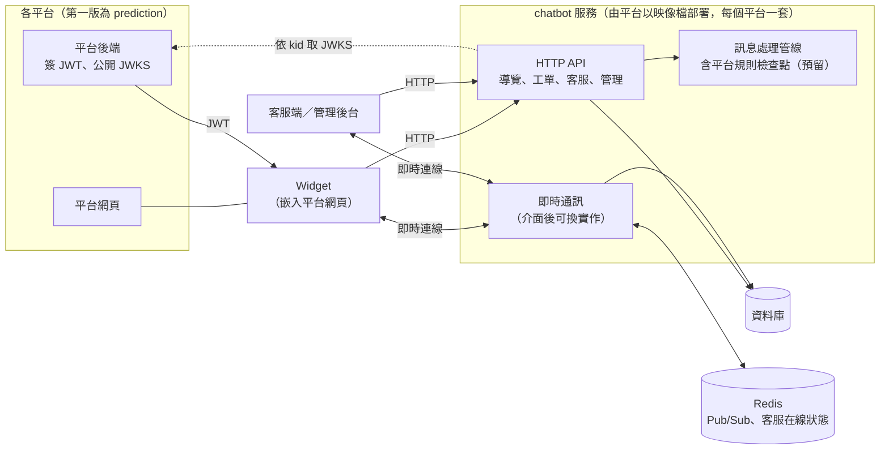
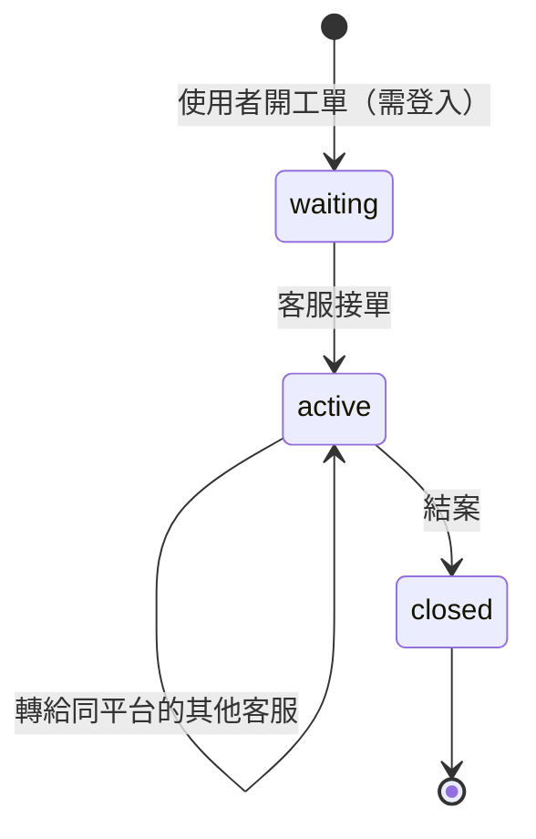
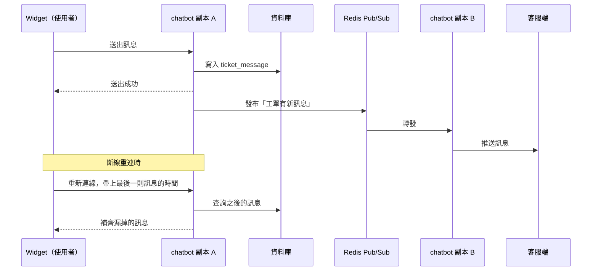
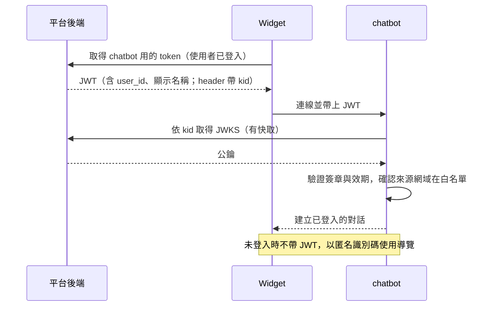

# Chatbot 最小可行方案

**版本日期：** 2026-10-20

Chatbot 第一版要怎麼做。需求以 [`requirements.md`](./requirements.md) 為準，本文件不重複需求；未來擴充見 [`roadmap.md`](./roadmap.md)，實作排期見 [`schedule.md`](./schedule.md)。

---

## 一、範圍與定案

| 項目 | 定案 |
| --- | --- |
| 形態 | **獨立服務＋插件 Widget，以容器映像檔交付，各平台自行部署**；每個平台一套，資料庫與帳號不共用；理由見 [`requirements.md`](./requirements.md) §七 |
| 升級 | 各平台自行決定升級時間；每一版都能從舊版跨版升級 |
| 對外介面 | **API-first**：Widget 只透過 Client API 與服務溝通；第一版 API 不承諾對外穩定，正式開放見 [`roadmap.md`](./roadmap.md) P2 |
| 第一個接入的平台 | prediction，入口為 forum、voting |
| 互動 | 只有按鈕，不開放自由輸入；不做比對引擎、不用 LLM |
| 使用者 | 未登入也可使用導覽；**開工單需登入** |
| 轉人工 | **即時對話＋離線留言，用同一張工單**：客服在線時即時對話，不在線時留言、客服上線後回覆 |
| 通知 | 訊息即時推送；聊天窗以未讀數提示 |
| 客服 | **各平台各自處理**：客服與營運帳號存在該平台那套 chatbot 自己的表裡，看不到其他平台的工單 |
| 工單資料 | 第一版建表，欄位對齊 CRM 客服工單，日後併入 CRM |
| 平台專屬規則 | 第一版不做（例如 prediction 的「不得預測或建議」），只預留掛載位置 |
| 問答分類範圍 | 待定 |


### 系統架構



- 單純導覽只走 HTTP；開了工單的使用者與客服才建立即時連線
- 多個 chatbot 副本之間以 Redis Pub/Sub 轉發訊息
- 資料庫與 Redis 由部署的平台準備，不與其他平台共用
- Widget 的 bundle 由同一套 chatbot 提供，前後端版本一致

---

## 二、功能模組

### 2.1 聊天窗（Widget）

- 以少量程式碼嵌入平台網頁，script 從該平台部署的 chatbot 載入；以 Shadow DOM 隔離樣式
- 浮窗開關、訊息列表；導覽**只有按鈕**，每層都有「上一步」「回主選單」
- 依來源頁面顯示不同的起始選單
- 未登入也可使用導覽
- 浮窗按鈕顯示未讀數
- 「我的工單」頁：列出自己開過的工單與對話紀錄（需登入）
- 斷線或重新整理後，對話不遺失

### 2.2 選單導覽

- 節點兩種：**選單節點**（列出子選項）、**答案節點**（顯示回答）
- 答案節點底部固定放「有幫助／沒幫助」與「找客服」
- 每個分類的最後放「沒有我要的問題」，連到工單

### 2.3 工單與即時對話



- **客服在線**：工單建立後即指派給在線客服接單，雙方即時對話
- **客服不在線**：工單維持 waiting，使用者的訊息照常保存；客服上線後接單回覆，使用者打開聊天窗看到未讀

- 使用者與客服的訊息都存成工單訊息；**先寫進資料庫，再推送**，推送失敗也不會掉訊息
- 工單是唯一可以自由輸入文字的地方

### 2.4 即時通訊

- 使用者與客服之間以即時連線互傳訊息；多副本之間透過 Redis Pub/Sub 轉發
- 連線中斷時退回輪詢；重新連上時依訊息時間補抓漏掉的訊息
- 只有開了工單的使用者與客服需要即時連線；單純導覽走一般 HTTP
- **服務內部只依賴「推送訊息給某個連線」的介面**：自建 WebSocket 或沿用現有 WS Hub 尚未決定，之後換實作不必改業務邏輯



### 2.5 客服端

- 以這套 chatbot 自己的客服帳號登入
- 設定在線／離線
- 等待中工單列表；接單、即時對話、轉給同平台的其他客服、結案
- 看到使用者開工單前的導覽路徑
- 查詢過去的工單

### 2.6 管理後台

- **選單編輯**：節點新增、編輯、排序、啟用／停用（樹狀拖拉）
- **頁面入口設定**：哪個頁面對應哪個起始節點
- **紀錄查詢**：導覽紀錄、對話紀錄
- **統計報表**：各節點點擊數、熱門問題、路徑漏斗、「沒幫助」比例、轉客服率；匯出 CSV
- **帳號**：管理員在後台開立客服與營運帳號；第一個管理員由部署方以 CLI 建立
- **稽核**：後台操作留下紀錄
- **權限**：管理員、客服

### 2.7 平台接入

- **身分轉接**：平台後端簽標準 JWT（header 帶 `kid`），並公開 JWKS；chatbot 依 `kid` 從設定的 JWKS 位址取得公鑰驗證，換金鑰不必改 chatbot。不限平台的技術棧；Python 平台可直接用 `scitw_auth` 簽發、`build_jwks` 公開。chatbot 不另做登入，也不保存使用者個資，只存識別碼與顯示名稱
- **網域白名單**：只有授權的網站能載入聊天窗
- **部署設定**：允許的網域、JWKS 位址、外觀、資料庫與 Redis 連線，以環境變數或設定檔提供，不建表



### 2.8 平台專屬規則（預留）

- 訊息處理管線在「回覆送出前」預留檢查點，各平台可掛自己的規則
- 第一版不實作任何規則；prediction 的合規檢查之後掛在這裡

### 2.9 基礎防護

- 工單與對話訊息：限流、長度上限、敏感詞過濾

### 2.10 事件拋送（預留）

- 導覽與工單事件寫出到事件管道（只寫出，第一版無人消費；日後供 CRM 使用）

### 2.11 Client API（API-first）

- Widget 只呼叫公開的 Client API，不走內部捷徑；日後平台不用 Widget、自做介面時，用的是同一組 API
- 路徑帶版本前綴 `/v1`，由 FastAPI 產出 OpenAPI 文件
- 身分與 Widget 相同：使用者以平台簽的 JWT，未登入以匿名識別碼
- 即時連線的事件類型、重連後補抓訊息的規則寫成文件，作為日後公開協議的基礎
- 第一版 API 標為內部，不承諾對外穩定；正式開放（版本政策、平台 API 金鑰與限流、點擊事件回報規範）見 [`roadmap.md`](./roadmap.md) P2

### 2.12 交付與部署

- **交付物**：帶版本號的容器映像檔、設定項目說明、部署文件（列明需要的資料庫與 Redis）、每一版的升級說明
- 各平台自行部署，自行決定升級時間
- 資料庫 migration 要支援從任一舊版跨版升級
- 第一個管理員帳號由部署方以 CLI 建立

---

## 三、選單規則（預設值）

| 項目 | 預設值 | 理由 |
| --- | --- | --- |
| 選單層數 | 最多 3 層，不含答案頁（例如 分類 → 子分類 → 問題 → 答案） | 超過 3 層容易迷路離開 |
| 每層選項數 | 最多 7 個 | 手機一屏看得完，不用捲動 |
| 答案長度 | 最多 500 字 | 超過就拆成兩題，或改連到說明頁 |
| 答案格式 | 純文字＋粗體、清單、連結（Markdown 子集） | 前台好渲染、後台編輯器簡單；圖片之後再加 |
| 固定按鈕 | 每層都有「上一步」「回主選單」；每個分類最後一項固定為「沒有我要的問題 → 開工單」 | 每一層都有出口 |
| 共通問題 | forum、voting 兩棵樹各放一份（例如帳號、登入） | 共用子樹之後再做 |

---

## 四、資料表

每個平台各自一套資料庫，表內不帶 `platform_id`。平台設定（允許的網域、JWKS 位址、外觀）放在部署設定，不建表。

```
agent           (id, name, role[admin|agent], status)
tree_node       (id, parent_id, type[menu|answer], title, content, sort, status)
entry_point     (id, page_key, root_node_id)      -- prediction 第一版 page_key：forum、voting
chat_session    (id, user_id NULL, source_page, started_at)   -- 未登入時 user_id 為空
click_log       (id, session_id, node_id, ts)
feedback        (id, session_id, node_id, helpful, ts)
ticket          (id, session_id, user_id NOT NULL, content, path_snapshot,
                 status[waiting|active|closed], assignee, ts)
ticket_message  (id, ticket_id, sender_type[user|agent|system], sender_id, content, ts, read_at)
audit_log       (id, actor_id, action, target, ts)
```

- `ticket`：原有欄位全部保留；欄位對齊 CRM 的客服工單，CRM 上線後併入
- `ticket.user_id` 不可為空：開工單需登入，回覆才送得回使用者
- `ticket_message`：使用者、客服與系統訊息（例如「客服已接單」）；`read_at` 為空且 `sender_type` 不是 user 的筆數，即使用者的未讀數
- `agent`：客服與營運帳號存在這套 chatbot 自己的表裡，與平台的使用者帳號無關
- 客服在線狀態放在 Redis，不寫進資料庫

---

## 五、成功標準

第一版以**整條流程跑得通**為驗收：

1. 未登入使用者在 prediction 的 forum 或 voting 打開聊天窗，點到答案並送出回饋
2. 客服在線時：登入使用者開工單 → 客服接單 → 雙方即時對話 → 結案
3. 客服離線時：使用者開工單並留言 → 客服上線後回覆 → 使用者打開聊天窗看到未讀與回覆
4. 斷線重連後，漏掉的訊息會補齊
5. 依部署文件，以映像檔在乾淨環境部署成功；從前一版升級時 migration 正常
6. 營運在後台修改選單，前台立即生效
7. 報表數字與原始資料對得上

上線後再依實際資料補上使用面的指標（例如轉客服率），作為 [`roadmap.md`](./roadmap.md) 各階段的觸發依據。

---

## 六、取捨

- **按鈕導覽**：開發快、答案完全可控、不會答錯；代價是使用者得自己找到問題在哪一層，所以選單控制在 3 層、每層 7 個選項以內
- **獨立服務、各平台自行部署**：可以接入任何技術棧的平台、流量與主業務隔離、不需要集中的維運負責人；代價是修正要等各平台升級才生效，各平台可能停在不同版本，所以每一版都要支援跨版升級；身分也要跨服務驗證
- **即時對話與離線留言共用一張工單**：資料模型只有一套，客服在不在線只影響回覆速度；代價是第一版就要做即時通訊
- **API-first**：Widget 不走內部捷徑，日後開放 Client API 時不必另做一套；代價是第一版的 API 設計要比只給自家前端用時更謹慎
- **每個平台一套部署**：資料與帳號天然隔離，不需要 `platform_id`；代價是無法跨平台彙整報表或共用客服，日後若要集中，就得合併各平台的資料庫
