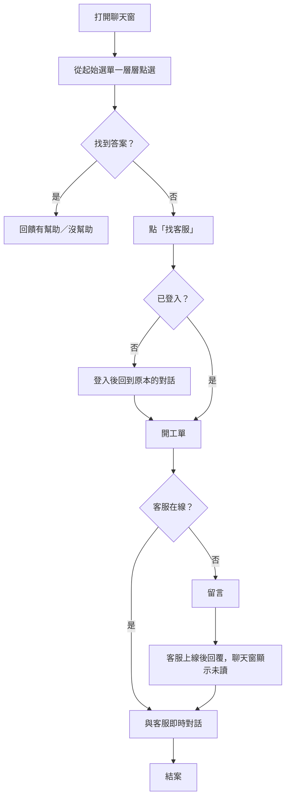

# Chatbot 需求文件

**版本日期：** 2026-10-13

本文件只描述 chatbot **要做到什麼**，不描述實作方式。架構決策的依據與結論見 §七。

---

## 一、目標與範圍

**目標**：做一個可以嵌入多個平台的 chatbot，提供導覽和客服對話。第一個接入的是 prediction，之後陸續接入其他平台。

**優先順序**：架構 → 平台化 → 平台專屬擴充 → 進階對話

**第一版範圍**

- 聊天窗
- 選單導覽
- 工單，以及與客服的即時對話
- 客服端介面
- 管理後台

**明確不做（第一版）**：自由輸入、LLM、個人化查詢、多語、各平台專屬的規則（例如 prediction 合規）

---

## 二、使用者角色

| 角色 | 說明 |
| --- | --- |
| 訪客 | 未登入的平台使用者 |
| 登入使用者 | 已登入的平台使用者 |
| 客服 | 回覆使用者、處理工單；**每位客服只屬於一個平台** |
| 營運管理者 | 維護選單內容、查看紀錄與報表；只管理自己的平台 |
| 平台接入方 | 要把 chatbot 裝到自己平台的開發團隊 |

---

## 三、功能需求

優先度：**P0** 為初版必備，**P1** 為平台化，**P2** 為之後再做。

### 主要使用流程

### 3.1 訪客／登入使用者

| # | 需求 | 優先度 |
| --- | --- | --- |
| U1 | 在平台頁面上打開或關閉聊天窗 | P0 |
| U2 | 透過按鈕選單一層層找到答案，可以「上一步」「回主選單」 | P0 |
| U3 | 在不同頁面打開時，看到對應該頁面的起始選單 | P0 |
| U4 | 對答案回饋「有幫助／沒幫助」 | P0 |
| U5 | 訪客可以使用導覽，不必登入 | P0 |
| U6 | 選單找不到答案時，可以「找客服」；**需要登入**，未登入者會被導向登入，登入後回到原本的對話 | P0 |
| U7 | 客服在線時即時對話 | P0 |
| U8 | 客服不在線時仍可留言，客服上線後回覆 | P0 |
| U9 | 聊天窗上顯示未讀的客服回覆數 | P0 |
| U10 | 查看自己過去的工單和對話紀錄 | P0 |
| U11 | 斷線或重新整理頁面後，對話不會遺失 | P0 |

### 3.2 客服

| # | 需求 | 優先度 |
| --- | --- | --- |
| A1 | 登入客服介面，設定自己在線或離線 | P0 |
| A2 | 看到等待中的工單，接單後即時對話 | P0 |
| A3 | 看到使用者開工單前的導覽路徑 | P0 |
| A4 | 工單可以指派、轉給同平台的其他客服、結案 | P0 |
| A5 | 查詢過去的工單 | P0 |
| A6 | 只看得到自己所屬平台的工單 | P0 |

### 3.3 營運管理者

| # | 需求 | 優先度 |
| --- | --- | --- |
| O1 | 維護選單：新增、編輯、排序、停用 | P0 |
| O2 | 設定哪個頁面對應哪個起始選單 | P0 |
| O3 | 查詢導覽紀錄與對話紀錄 | P0 |
| O4 | 報表：熱門問題、路徑漏斗、「沒幫助」比例、轉客服率 | P0 |
| O5 | 各平台的選單與報表分開管理，只看得到自己的平台 | P0 |
| O6 | 後台操作留下稽核紀錄 | P0 |

### 3.4 平台接入方

| # | 需求 | 優先度 |
| --- | --- | --- |
| P1 | 用少量程式碼把聊天窗嵌入自己的網頁 | P0（先給 prediction 用） |
| P2 | 把自己平台的登入身分傳給 chatbot，不需要 chatbot 另外登入 | P0 |
| P3 | 依自己的品牌設定外觀 | P1 |
| P4 | 照著接入文件自己完成接入，不需要 chatbot 團隊協助 | P1 |
| P5 | 掛上平台專屬的規則，例如 prediction 的合規檢查 | P2 |
| P6 | 不用 Widget，改以 Client API 自做介面（例如原生 App、特殊版型） | P1 |

---

## 四、非功能需求

以下數字為預設值，上線後依實際資料調整。

| 類別 | 需求 |
| --- | --- |
| 即時性 | 使用者與客服之間的訊息延遲 p95 ≤ 1 秒；即時連線中斷、改用輪詢時 ≤ 5 秒 |
| 可靠性 | 訊息不會遺失；斷線後重新連上，3 秒內補齊漏掉的訊息 |
| 可用性 | 每月 99.5% |
| 資料隔離 | 平台之間的選單、對話、工單、報表互相看不到 |
| 流量隔離 | chatbot 的流量（尤其是即時對話）不得影響各平台主業務的 API |
| 安全 | 只有授權的網站能載入聊天窗；chatbot 不保存平台使用者的個資，只存識別碼和顯示名稱 |
| 樣式 | 聊天窗不影響宿主頁面的樣式，宿主頁面也不影響聊天窗 |
| 擴充性 | 新增平台不需要改 chatbot 的程式碼，只需要設定 |
| 可演進 | 之後要加自由輸入、LLM、平台專屬規則時，不需要重寫既有功能 |
| 獨立升級 | chatbot 可以獨立發布與升級，不需要配合任何平台的發布時程 |
| 規模 | 第一年最多 5 個平台，架構要能撐到 10 個；每個平台同時進行中的客服對話 ≤ 50 個；全系統同時的即時連線 ≤ 1,000 條；量不夠時以水平擴充處理，不改程式碼 |
| 資料保留 | 工單與對話訊息 2 年；導覽點擊紀錄 180 天（彙總成報表後刪除原始資料）；匿名導覽 session 90 天；後台稽核紀錄依公司規範，至少 1 年 |

---

## 五、限制條件

- 第一個接入的是 prediction，入口在 forum 和 voting
- 初版就要支援客服即時對話
- 工單欄位要保留，日後要能併入 CRM（設計文件規定客服工單是 CRM 的單一來源）
- 接入的平台不全在 `backend-api-server` 這個 codebase 裡
- 平台專屬規則（例如 prediction 的「不得預測或建議」）優先度靠後，但架構上要預留掛載的位置

---

## 六、未來需求（只列出，不排程）

- 自由輸入（以按鈕為主、輸入框為輔）
- 預測類問句攔截（prediction 專屬）
- LLM 對話
- 推薦與彙整文章、議題
- 依使用者狀態動態調整選單
- 個人化查詢，例如我的投票紀錄
- 頁面上下文：在某個市場頁打開時，直接解釋該市場
- 通知訂閱
- 多語
- Server API 與 Webhook：平台後端代替使用者開工單、查詢工單、接收工單事件

---

## 七、架構決策依據

### 7.1 決策問題與答案

| 問題 | 答案 | 偏向 |
| --- | --- | --- |
| 接入的平台是否都在 `backend-api-server` 裡？ | 有平台不在裡面 | **獨立 repo**（決定性：併入 backend 的話，不在裡面的平台無法接入） |
| 各平台的客服是否同一組人？ | 各平台各自處理 | 偏併入；但獨立 repo 以「客服只屬於一個平台」同樣可滿足 |
| chatbot 是否需要獨立升級？ | 需要 | **獨立 repo** |
| 即時對話的流量是否需要與主業務隔離？ | 需要 | **獨立 repo** |

### 7.2 結論

**以獨立 repo、獨立服務為目標設計。**

「客服各平台各自處理」在獨立 repo 下的處理方式：

- 不需要跨平台的分流與集中處理
- 每位客服帳號只屬於一個平台，看不到其他平台的工單
- 客服介面只做一套，依登入帳號所屬的平台顯示資料
- 資料從第一版起就以平台區隔（A6、O5 列為 P0）

### 7.3 未決事項

| 事項 | 現況 | 會卡到什麼 | 架構上的預留 |
| --- | --- | --- | --- |
| prediction 接入時程 | 尚未規劃 | 排期 | — |
| 維運負責人、雲端環境（GCP 或 AWS） | 未決策 | 部署流程 | 服務容器化，兩邊都能部署 |
| WebSocket 自建或沿用現有 WS Hub | 未決策 | 即時通訊的實作 | 內部只依賴「推送訊息給某個連線」的介面，背後實作可替換 |
